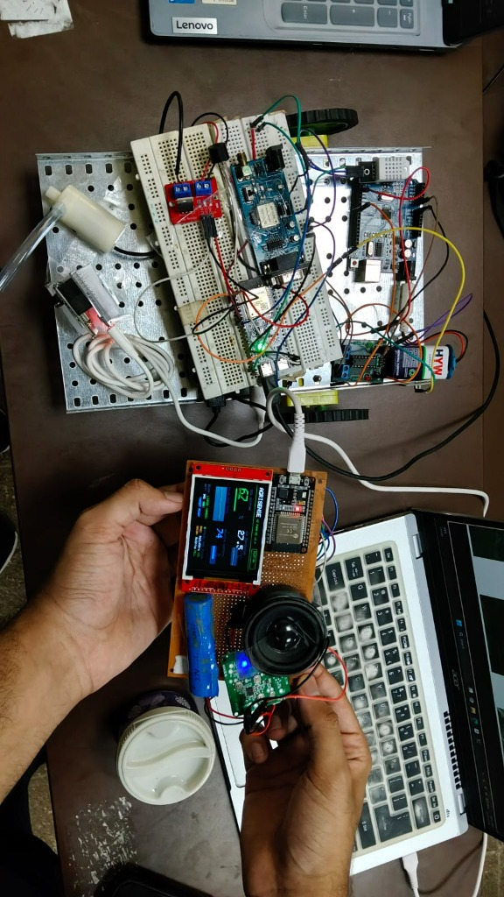
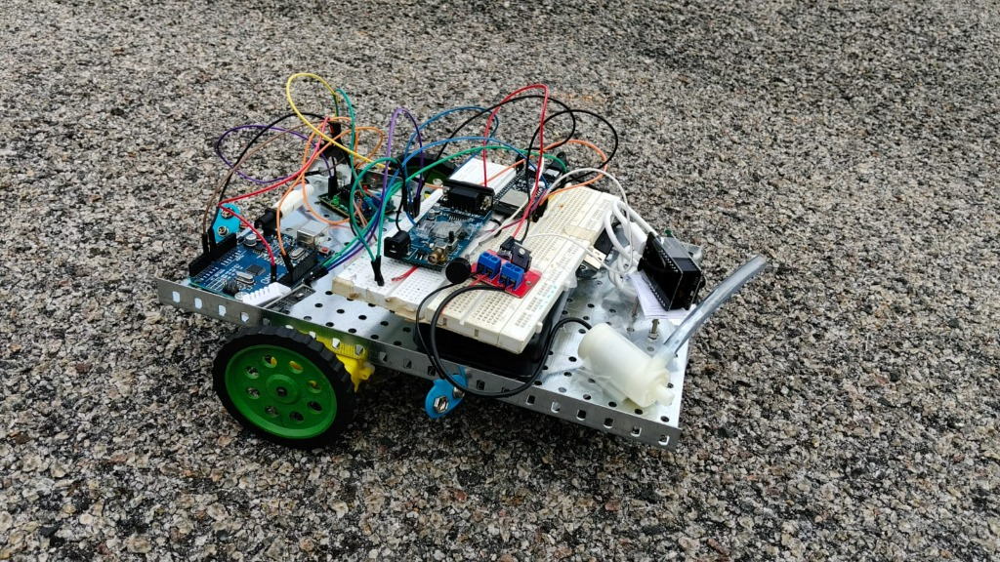

# AgriSense & AgriMarket AI

### Integrated Smart Agriculture, Satellite Crop Intelligence & AI-Powered Agricultural Supply Chain Platform

> **Hackathon Prototype MVP** built in complete accordance with all 100 sections of [`PRD.md`](./PRD.md).

---

## 🌟 Overview & Product Vision

AgriSense & AgriMarket AI connects **physical farm sensing, satellite crop analytics, and farmer-to-farmer commerce** into a single cohesive platform:

```text
    PHYSICAL FARM
         │
         ├── ESP32 Microcontroller Node
         │     ├── Capacitive Soil Moisture Sensor (ADC GPIO 34)
         │     ├── DHT22 Temperature & Humidity Sensor (GPIO 15)
         │     ├── 2.3" ST7789 Color TFT LCD (320x240 SPI)
         │     └── 2.4kHz Active Piezo Buzzer (PWM GPIO 25)
         │
         ▼
    AGRISENSE TELEMETRY & DASHBOARD
         │
         ├── Real-Time Telemetry & Alert Engine
         ├── ST7789 2.3" LCD Canvas Hardware Emulator
         ├── Web Audio API Piezo Buzzer Audio Synthesizer
         └── Dynamic SVG Trend Charts (1H, 6H, 24H, 7D, 30D)
         │
         ▼
    SATELLITE CROP INTELLIGENCE
         │
         ├── 12.4 Ha Orbital Agricultural Parcel Viewer
         ├── Spectral NDVI (Normalized Difference Vegetation Index)
         ├── MobileNetV2 (Edge Quantized) & Agronomic CNN Models
         └── 6-Stage Crop Phenology Timeline (Seeding → Harvest)
         │
         ▼
    AGRIMARKET (Voice-First Multilingual Commerce)
         │
         ├── Community Social Marketplace (Seeds, Fertilizers, Tractors)
         ├── Rental Equipment & Purchase Workflows
         ├── Sarvam AI Indic NLU Voice Assistant (KN, HI, EN, TA, TE)
         ├── Multi-Agent Orchestrator (Market, Product, Order Agents)
         ├── Human-in-the-Loop Safe Order Confirmation
         └── 5-Stage Supply Chain Logistics Stepper
```


---
## 📸 Physical Hardware & Autonomous Field Rover Prototype

The **AgriSense** cyber-physical hardware deployment features two custom-built, field-tested IoT edge systems designed for smart precision agriculture and hands-free autonomous operation:

1. **Handheld Farm Diagnostics & Voice Terminal Node**:
   - Continuous root-zone soil telemetry monitoring & atmospheric microclimate tracking.
   - Onboard 2.3" high-resolution SPI color TFT display running embedded **AGRISENSE AI FARM OS**.
   - Integrated digital audio amplifier with full-range speaker for local Indic voice alerts and audible buzzer warnings.
   - Dedicated rechargeable Li-ion battery pack with micro-USB telemetry uplink.
2. **Autonomous Agricultural Field Rover (Robotic Tractor & Dosing Platform)**:
   - Heavy-duty perforated aluminum chassis with dual-deck isolation for power and compute electronics.
   - Differential drive locomotion with high-traction green rubber all-terrain wheels and front omnidirectional ball caster.
   - Onboard submersible precision micro-dosing pump and transparent tubing for targeted root irrigation and bio-pesticide delivery.
   - Dual-brain compute architecture pairing Arduino Uno (motor/actuator control) with ESP32 (IoT telemetry & TrueForge agent link).

---

### Figure 1: Handheld IoT Edge Terminal Node & Autonomous Field Rover Workstation


#### Technical Breakdown & Operating Metrics:
- **Embedded Color TFT Interface (Real-Time Physical Node Output)**:
  - **Soil Moisture**: `62%` (Optimal root-zone hydration for crop growth)
  - **Canopy Temperature**: `27.5°C`
  - **Relative Air Humidity**: `74%`
- **Integrated Voice & Speaker Subsystem**:
  - Direct PAM-class audio amplifier breakout powering an onboard magnetic speaker, enabling offline and edge voice synthesis alerts in native Indian languages.
- **Master Field Station Integration**:
  - Live serial & Wi-Fi uplink linking the handheld hardware node to the local FastAPI + TrueForge agent control plane on the laptop workstation, synchronizing with the background agricultural rover chassis.

---

### Figure 2: Autonomous Agricultural Field Rover (Robotic Platform) in Outdoor Terrain


#### Technical Breakdown & Mechanical Architecture:
- **Perforated Aluminum Industrial Chassis**:
  - Engineered for rugged agricultural environments, providing flexible component mounting, optimal heat dissipation, and mechanical rigidity across uneven terrain.
- **Precision Micro-Irrigation & Spot-Dosing Subsystem**:
  - High-efficiency 5V/12V submersible fluid pump coupled with flexible silicone delivery tubing, allowing the autonomous rover to dispense precise millilitre doses of liquid fertilizer or bio-pesticide directly at the root crown.
- **High-Traction All-Terrain Mobility**:
  - Dual high-torque geared DC drive motors coupled to ribbed tread green polymer wheels for high torque on loose dirt, mulch, and asphalt.
  - Front smooth-pivot steel caster ball providing zero-turning-radius differential mobility for tight crop-row navigation.
- **Electronics & Control Stack**:
  - Arduino Uno microcontroller handling low-level motor PWM, relay triggering, and IR furrow/obstacle sensors.
  - Secondary ESP32 edge node streaming rover telemetry and receiving autonomous mission waypoints from the TrueForge Chief-of-Staff agent harness.

---

### Figure 1: ESP32 IoT Edge Sensor Node & Live SPI Color TFT Dashboard


#### Technical Breakdown & Working Principle:
- **Core Microcontroller (ESP32 DevKit / NodeMCU-32S)**:
  - Powered by a dual-core 32-bit Xtensa LX6 microprocessor clocked at 240 MHz with 520 KB SRAM.
  - Native 2.4 GHz 802.11 b/g/n Wi-Fi and Bluetooth v4.2 / BLE.
  - Implements multi-threaded execution: Core 1 handles high-speed ADC sampling, digital filtering, and local SPI graphics rendering; Core 0 manages Wi-Fi networking, HTTP REST, and MQTT telemetry streaming.
- **High-Speed SPI Color TFT LCD Display (ILI9341 / ST7789)**:
  - Runs the embedded **AGRISENSE AI FARM OS v2.4** graphical interface:
    - **Active Field Parcel**: `Plot-4B: Corn Field`
    - **Volumetric Soil Moisture**: `48%` (Optimal root-zone hydration)
    - **Ambient Canopy Temperature**: `27.0°C`
    - **Relative Air Humidity**: `67%`
    - **System Diagnostic Status**: `"All Systems Normal"` (Green status badge indicating ideal agronomic parameters)
  - Enables farmers to conduct instant on-site field inspections directly from the breadboard/enclosure without needing an internet connection or smartphone.
- **Dual-Prong Soil Moisture Sensing Probe**:
  - Measures soil volumetric water content (VWC) via electrical conductivity / dielectric permittivity.
  - Connected to ESP32 ADC1 Channel 6 (GPIO 34) with 12-bit analog-to-digital resolution (0–4095), normalized into 0–100% hydration scale with temperature compensation.
- **DHT11 / DHT22 Digital Climate Sensor**:
  - Single-wire digital bus connected to GPIO 15, reading ambient temperature (±0.5°C) and relative air humidity (±2–5% RH) to calculate Vapor Pressure Deficit (VPD) and fungal/pest risk indices.
- **High-Decibel Active Alarm Buzzer**:
  - Connected to GPIO 5 with PWM tone generation.
  - **Smart Protection Alert**: Operates in silent mode during standard moisture levels (e.g. 27%–84%), and emits a continuous high-frequency pulsed alarm **only when soil moisture exceeds 85%**, warning farmers against severe waterlogging, anaerobic root rot, or burst irrigation lines.

---

### Figure 2: Integrated Field Testbed — Fixed IoT Node & Autonomous Rover
.jpeg)

#### Technical Breakdown & System Synergy:
- **Unified Cyber-Physical Ecosystem**:
  - Showcases the end-to-end integration between the **stationary soil and atmospheric sensing station** (left) and the **autonomous agricultural rover** (right) in the laboratory testbed.
  - Solves the spatial resolution challenge of modern precision agriculture: fixed nodes continuously capture deep temporal telemetry at high-priority zones, while the mobile rover provides spatial coverage across expansive agricultural plots.
- **Edge-to-Cloud Telemetry Synchronization**:
  - The ESP32 node packages sensor telemetry into structured JSON packets every 2000ms:
    ```json
    {
      "nodeId": "ESP32-PLOT-4B",
      "soilMoisture": 48.0,
      "temperature": 27.0,
      "humidity": 67.0,
      "status": "NORMAL",
      "timestamp": "2026-09-25T12:04:13Z"
    }
    ```
  - Data streams over Wi-Fi to the AgriSense Node.js server (`/api/telemetry`), synchronizing in real time with the web dashboard, the virtual LCD canvas hardware emulator, and the HeyCall-E AI voice assistant.

---

### Figure 3: Autonomous Agricultural Rover Chassis & Motor Drive Subsystem


#### Technical Breakdown & Mechanical Architecture:
- **Dual-Deck Modular Chassis Design**:
  - Built with laser-cut dual acrylic plates separated by heavy-duty nylon standoffs.
  - Provides physical and electrical isolation: high-current inductive motor wiring and battery power packs occupy the lower deck, while sensitive microcontroller brains and logic wiring are protected on the upper deck.
- **High-Torque TT Geared DC Motors & High-Traction Wheels**:
  - Powered by twin dual-shaft TT DC gear motors with a 1:48 gear ratio, producing high low-end torque essential for overcoming loose soil, mud, and furrow resistance.
  - High-friction grooved rubber tires mounted on custom green polymer rims provide optimal ground adhesion across rough field terrain.
- **H-Bridge Dual Motor Driver Interface**:
  - Integrates an onboard dual H-bridge motor driver (L298N / L293D architecture) equipped with heavy-duty blue screw terminals for motor phase outputs and external DC power input.
  - Enables bidirectional PWM speed regulation, forward/reverse drive, and zero-radius differential steering (skid-steer mode).

---

### Figure 4: Crop-Row Navigation, Obstacle Sensing Array & Mobility Architecture


#### Technical Breakdown & Autonomous Guidance:
- **Dual Forward Infrared (IR) Sensor Array**:
  - Positioned on the forward bumper extension close to the ground plane for continuous surface reflection scanning.
  - Each module integrates high-frequency IR emitter-detector pairs with onboard LM393 comparators and precision sensitivity trim potentiometers.
  - **Autonomous Field Capabilities**:
    1. **Crop-Row & Furrow Following**: Tracks contrast boundaries between crop furrows, mulch lines, or irrigation corridors, allowing autonomous line-guided field traversal.
    2. **Ground Obstacle Collision Avoidance**: Detects stones, raised irrigation piping, or fencing ahead to automatically execute corrective steering or safety halts.
- **Low-Friction Omnidirectional Front Caster**:
  - A heavy-duty steel/nylon ball caster wheel mounted under the front chassis provides smooth 3-point kinematic support, enabling smooth 360° turning without steering servo linkages.
- **Noise-Isolated Wiring Harness**:
  - Separate power buses and common grounding between motor power and digital sensor inputs prevent motor back-EMF spikes from affecting sensitive analog-to-digital conversions.

---

## 🛠️ Hardware Pinout & Circuit Schematic Mapping

| Peripheral / Module | ESP32 Pin | Interface Type | Functional Role |
|---|---|---|---|
| **ST7789 / ILI9341 TFT MOSI** | `GPIO 23` | VSPI MOSI | SPI Display Data Transmission |
| **ST7789 / ILI9341 TFT SCK** | `GPIO 18` | VSPI SCK | SPI Display Clock Signal |
| **TFT Chip Select (CS)** | `GPIO 5` | GPIO Output | SPI Display Enable/Select |
| **TFT Data/Command (DC)** | `GPIO 2` | GPIO Output | Register Command vs Data Selection |
| **TFT Reset (RST)** | `GPIO 4` | GPIO Output | Display Hardware Reset |
| **Capacitive Soil Moisture Sensor** | `GPIO 34` | ADC1_CH6 (Analog) | Root-zone volumetric water content (0–100%) |
| **DHT11 / DHT22 Sensor** | `GPIO 15` | Single-Bus Digital | Ambient air temperature and relative humidity |
| **Active Piezo Buzzer** | `GPIO 5` / `GPIO 25` | PWM Output | High-frequency alert when moisture > 85% |
| **Rover Motor Left (PWM / DIR)** | `GPIO 12, 14` | Timer PWM | Left drive wheel forward/reverse speed control |
| **Rover Motor Right (PWM / DIR)**| `GPIO 27, 26` | Timer PWM | Right drive wheel forward/reverse speed control |
| **Front Left IR Sensor** | `GPIO 32` | Digital Input | Crop-row / furrow line reflectance detection |
| **Front Right IR Sensor** | `GPIO 33` | Digital Input | Obstacle detection & row boundary sensing |

---

## 💻 Firmware Source Code

The complete C++ Arduino source code for the ESP32 sensing node and rover navigation logic is available inside:
- [`devices.html`](./devices.html) (Interactive browser-based hardware inspector & firmware copy tool)
- [`esp32_firmware.ino`](./esp32_firmware.ino) (Direct flash-ready sketch for Arduino IDE / PlatformIO with >85% moisture alarm logic)
